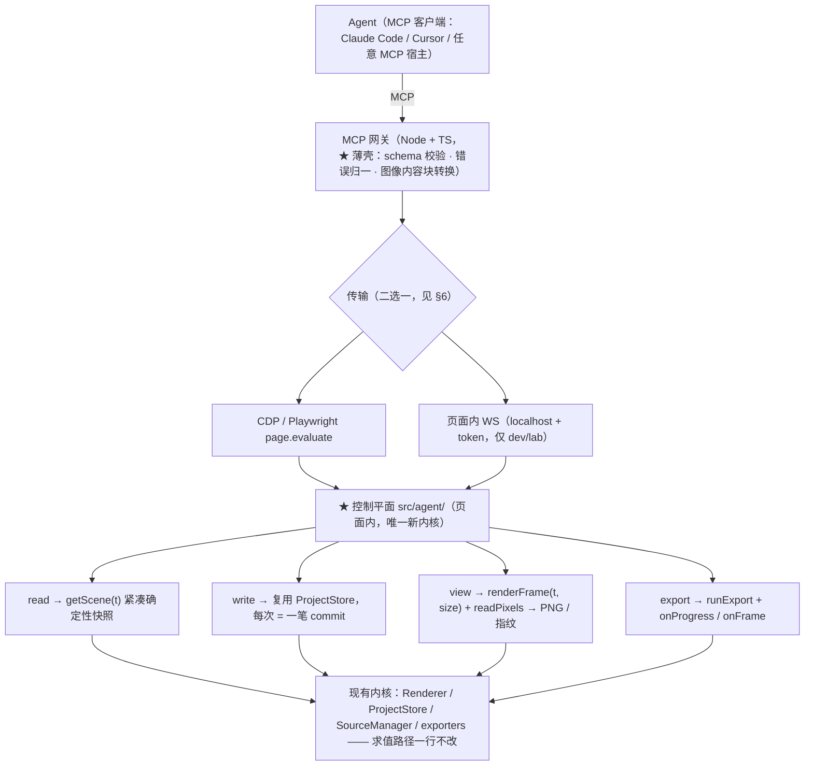

# Agent 控制平面

> 状态：**M0–M4 已实现**；v2（2026-10-18）补了排版写入、插件作者面与应用内模型运行时，
> 见 §10 ｜ 约束真源：`src/agent/AGENTS.md` + 根 `AGENTS.md`

**这份笔记回答一个问题**：怎样让 AI（编码 agent、MCP 客户端）方便地操控 Artmatic
—— 剪辑、设参数、拿视觉反馈、导出 —— 以及「要不要做一个 TypeScript CLI」。

---

## 0. 结论

**不做「复刻渲染引擎的独立命令行程序」。做「编辑器内控制平面（Control Plane）+ MCP 薄壳」。**

一句话分工：

| 谁 | 干什么 | 为什么是它 |
|---|---|---|
| **控制平面**（页面内，`src/agent/`） | 唯一的 agent 操作面：读场景 / 写工程 / 出图 / 导出 | 渲染只在浏览器里存在（见 §1.2），操作面必须跟着渲染走 |
| **MCP 网关**（Node 薄壳） | schema 校验 + 协议适配 + 转发 | 标准协议，任何 MCP 客户端即插即用；不含任何业务逻辑 |
| **驱动器 / CLI**（Node） | 拉起浏览器、投影工程文件 | 复用仓库里**已经跑通**的 `scripts/gen-*-thumbs.mjs` 范式 |

三条必须记住的判据：

1. **渲染不能在 Node 里发生**（硬约束 1.1 + 1.5）⇒ 任何 headless 渲染 CLI 都是第二条求值路径。
2. **写操作必须可撤销**（`CommandStack`）⇒ agent 的每一步都要是一笔 commit，用户能 Ctrl+Z 掉它。
3. **反馈要可复现**（种子化 + `renderFrame(project, t)` 纯求值）⇒ 同一个 t 永远同一张图，agent 才能做 A/B。

---

## 1. 问题与判据

### 1.1 「AI 操控编辑器」需要四类能力

| 能力 | agent 要做什么 | 本项目对应 |
|---|---|---|
| **读** | 看到工程结构：有哪些轨道 / 片段 / 特效链 / 关键帧 | `ProjectStore.project`（纯 JSON） |
| **写** | 剪辑（加 / 删 / 移 / 裁 / 切）、设参数、挂特效转场 | `ProjectStore` 的语义方法 |
| **看** | 得到视觉反馈，判断「改对没改对」 | `Renderer.renderFrame` + `readPixels` |
| **导** | 产出 mp4 / png 序列 / gif | `runExport` + 三个 `FrameSink` |

四类能力**都已经存在**，只是散落在 `__artmatic` 这个「E2E 调试口」里（`src/main.ts:128`）。
这份笔记要做的，是把它**提升成一个有版本、可发现、契约化**的接口。

### 1.2 为什么不能做「Node 里 headless 渲染」的 CLI

这是本方案唯一的硬否证，两条硬约束一起看：

- **硬约束 1.1**：唯一时钟是 `t`；预览与导出走**同一条**求值路径，差别只在分辨率。
- **硬约束 1.5**：内核是标准 Web 应用；**任何「只能在某个宿主壳里跑起来才能测」的功能设计都视为设计错误**。

推论：渲染路径依赖的东西**全部只在浏览器里**。

| 依赖 | Node 里的状态 |
|---|---|
| WebGL2 / GLSL ES 3.00（`engine/` 全套） | **不存在**。没有 GL 上下文，就没有一层画面。 |
| WebCodecs `VideoEncoder`（`exporters/mp4-sink.ts`） | **不存在**（Node 无 `VideoEncoder`）。 |
| `OffscreenCanvas` / 字体光栅（`typography/`） | 部分可用，但与浏览器实现有差异。 |
| `PerformanceObserver` / rAF 预览管线 | 不适用。 |

要在 Node 里补上这些，等于**再实现一遍渲染与编码**。那就是第二条求值路径——
不是「性能差一点」，是「预览对了、导出不对，而且不报错」。这正是硬约束 1.1 要防的事。

> 类比：`mediabunny` 是 MPL-2.0 的纯 JS 库，能在 Node 里跑容器封装 —— 但它**不提供编码器**，
> 编码仍要 WebCodecs。容器能在任何地方封，像素只能在浏览器里出。所以「拿 Node 封 mp4」
> 也没绕过这一条。

### 1.3 什么**可以**在 Node 里做

`src/core/` 是纯 TS、无 DOM、无 WebGL，`vitest` **现在就在 Node 里跑它**（`vite.config.ts:77`
的 `test.include` 限死 `tests/unit/**`）。可以搬进 Node 的有：

- schema / 迁移 / 校验：`schema.ts`（`SCHEMA_VERSION = 5`，`migrateProject`、`validateProject`、`cloneProject`）
- 片段几何：`clips.ts`（`applyTrimIn` / `earliestTrimStart` / `trimInOf`）
- 曲线求值：`curve.ts`
- 命令栈：`commands.ts`
- 种子随机：`prng.ts`
- 时间换算：`time.ts`、转场钳制：`transitions.ts`、位掩码：`bitmask.ts`、颜色：`color.ts`

所以：**CLI 有位置，但它是「工程文件工具」，不是「编辑器 CLI」**（见 §7）。

### 1.4 三条已经存在、必须复用的地基

| 地基 | 位置 | 对 agent 的意义 |
|---|---|---|
| 工程是纯 JSON，且是唯一真相 | `core/schema.ts` 的 `Project`；`AGENTS §5.1` | 读写契约天然存在，agent 可直接生成 / diff |
| 每次改动都是一笔快照事务 | `core/commands.ts`（`commit` / `beginTx` / `endTx` / `cancelTx`，`UNDO_MAX = 80`） | agent 的每一步天然可撤销 |
| 求值确定且可复现 | `core/prng.ts:39 withSeededRandom` / `:44 frameSeed`；`renderer.renderFrame(project, t)` | 反馈可回放，agent 能做严格的 A/B |

---

## 2. 目标架构与分层

### 2.1 五层



层与依赖：

- **Agent** 只认 MCP 工具，不认识 `project.json` 之外的任何东西。
- **MCP 网关**是薄壳：不含业务逻辑（业务逻辑在控制平面），只在传输与协议之间做适配。
- **传输**两选一，见 §6；**有头与无头共用同一控制平面**。
- **控制平面**是唯一新内核，通过注入的 `ControlContext` 拿运行期实例。
- **内核**（渲染 / 工程 / 导出）**一行不改**。

### 2.2 依赖方向

控制平面新模块落 **`src/agent/`**，与 `render/`（合成根）**同级**：

- `src/agent/` 依赖 `{ core, engine, exporters, effects, algos }`。
- `src/agent/` **不依赖 `ui/`**。运行期实例（当前工程 `ProjectStore`、`Renderer`、
  `AssetStore`、`playT`）通过**注入的 `ControlContext`** 拿到 —— 与 `platform/` 的注入是同一手法
  （硬约束 1.5 的解耦点）。
- 装配在 `src/main.ts`（它本来就 import `ui/app-state.svelte`）：把 `appState` 包成
  `ControlContext`，挂到 `window.__artmatic.control`。这样 `ui/` 之上的东西不必知道 agent 存在。

> 为什么强调「不依赖 ui」：`appState` 是 `ui/` 层的 `$state` 类。若控制平面直接 import 它，
> `src/agent/` 就被 `ui/` 反向绑住，将来 `/lab/` 或独立入口想复用控制平面时会成环。
> 注入点只有一处，代价极小。

### 2.3 与 `window.__artmatic` 的关系：**同源演进，不是替换**

`src/main.ts:128` 的 `__artmatic` 是控制平面的**前身**（E2E / 试炼场专用）。它已暴露：

`renderer` · `appState` · `theme` · `store`(getter) · `assets`(getter) · `project.*`（OPFS 持久化口）·
`projects()` · `renderFrame` · `readPixels` · `compileAll` · `makeTestVideo` · `videoStats` ·
`registerImageAsset` · `exportTiming` · `exportFrames` · `exportMp4Probe` · `algo.{listGenerators,defaultParams}` ·
`mascotStats` · `typoRasterize` · `typoStats` · `typoRegisterFont` · `typoFontStats` · `typoSetSubsetting`

**做法**：新增 `__artmatic.control`（协议化的控制平面），**保留 `__artmatic` 及其全部现有键不动**。
E2E 与 `scripts/gen-*-thumbs.mjs` 依赖那些键，动它们等于把仓库里唯一跑通的自动化拆了。
控制平面的内部实现可以复用 `__artmatic` 已暴露的能力（例如 OPFS 持久化口 `project.useOpfs`）。

### 2.4 四条设计纪律（违反会静默坏）

1. **复用 `renderer.renderFrame` / `runExport`，不许新开渲染路径**（硬约束 1.1）。
   出图/导出只准「临时钉尺寸 + 用完还原」，不许改写出帧逻辑。
2. **写操作一律走 `ProjectStore.commit(label, fn)`**（或 `beginTx`→`endTx`），**不许裸改 `project` 对象**。
   裸改的后果不是「看起来不对」，是撤销栈整个错乱 —— agent 的改动用户撤不掉（`AGENTS §4.2`
   的 `pendingGestureCancel` 悬空是同一类病）。
3. **读接口紧凑且确定**：返回 `getScene()` 而非整个 `project.json`；视觉反馈**优先给数值指纹**，
   仅在确需看图时取 PNG（见 §5）。
4. **安全边界**：页面内起 WebSocket 等于给任意本地页面开后门。优先 CDP/Playwright 驱动
   （零生产代码改动）；要起服务就 `localhost` + token + **仅 dev/lab 构建**（见 §6.4）。

---

## 3. 控制平面 API 契约

### 3.1 通用形态

- **统一返回**：`{ ok: true, data: T } | { ok: false, error: { code: string; message: string; detail?: unknown } }`。
  **不抛异常**（exception 跨传输层会丢类型）。`code` 是稳定的机器可读枚举，`message` 给人看。
- **版本化**：常量 `CONTROL_API_VERSION`（初始为 1，当前 4 —— 变更史见 §10 / §11）。
  `describe()` 返回 `{ apiVersion, appVersion, schemaVersion }`。网关在握手时校验主版本，
  不匹配就拒绝并给出明确错误。
- **异步**：全部方法返回 `Promise`（帧渲染、导出、持久化本来就有异步性）。
- **纯读无副作用**：`read` 类方法**不得**改动 `store.version`、不得推 `playT`、不得 `setExportSize`。
- **写操作等值**：写方法签名与 `ProjectStore` 的**既有方法一一对应**，**不新增语义**（映射表见 §3.3）。

### 3.2 read 类

| 方法 | 入参 | 返回 | 说明 |
|---|---|---|---|
| `describe()` | — | `{ apiVersion, appVersion, schemaVersion, fps, resolution, duration }` | 握手 / 能力协商 |
| `getScene(opt?)` | `{ t?: number; detail?: 'ids' \| 'full' }` | `SceneSnapshot` | **核心读接口**，见下 |
| `getCapabilities()` | — | `{ generators, effects, transitions, blendModes, fits, curveModes }` | 能力发现；agent 据此选择合法 id |
| `getClip(clipId)` | `clipId` | `ClipView \| null` | 单个片段（含关键帧、特效链） |
| `listProjects()` | — | `OpenProjectView[]` | 已打开的工程（等价现有 `__artmatic.projects()`） |
| `canUndo()` / `canRedo()` | — | `boolean` | 撤销栈状态 |

**`SceneSnapshot` 的形状**（紧凑、确定、可序列化）：

```ts
interface SceneSnapshot {
  t: number                    // 查询时刻（帧号）
  fps: number
  resolution: { w: number; h: number }
  duration: number             // 秒
  beatGrid: BeatGrid
  seed: number
  tracks: {
    id: string
    kind: 'visual' | 'audio'
    name: string
    enabled: boolean
    /** z 序 = 视觉轨数 - 1 - 视觉轨下标（AGENTS §4.1），由控制平面算好直接给 */
    z: number | null
    clips: ClipView[]
  }[]
}

interface ClipView {
  id: string
  kind: 'source' | 'effect' | 'audio'
  label: string
  start: number; end: number   // 秒
  fadeSec: number
  /** t 时刻是否命中（含出画转场窗口，转场窗口以 clip.end 为中心，见 AGENTS §5.5） */
  active: boolean
  source?: { type: 'video'|'image'|'algo'|'text'|'solid'; /* 判别字段按 type 给 */ }
  blend?: BlendMode
  opacity?: number
  transform?: { x: number; y: number; sx: number; sy: number; rot: number }
  fit?: 'contain' | 'cover' | 'stretch'
  transitionOut?: { defId: string; duration: number; values: Record<string, number> }
  chain?: { defId: string; values: Record<string, number>; enabled?: boolean }[]
  /** 只给「有键的曲线」，不铺开全部参数名 */
  curves?: Record<string, Curve>
}
```

设计要点：

- **`z` 由控制平面算好给出**。`AGENTS §4.1` 记着「写反的表现是特效完全无效且不报错」——
  这个换算不该让每个 agent 各自推一遍（`z = 视觉轨数 - 1 - 视觉轨下标`，只数视觉轨）。
- **`active` 由控制平面算好给出**：判断 t 是否命中片段要处理转场窗口（`transitionAt` 必须在
  span 过滤**之前**判）。让 agent 自己判会引入一整类边界 bug。
- **`detail: 'ids'` 只给 id / start / end / label**，用于 agent 在长工程里先探路再细读，省上下文。

### 3.3 write 类：与 `ProjectStore` 的映射表

> **纪律**：下表左列是控制平面方法，右列是它**唯一**的实现方式。控制平面**不新增语义**，
> 只是把 `ProjectStore` 的方法包成可跨传输层的形状。

| 控制平面方法 | 落到 `core/project-store.ts` | 入栈？ |
|---|---|---|
| `addTrack(kind, name?)` | `addTrack` (L146) | ✅ |
| `removeTrack(id)` | `removeTrack` (L160) | ✅ |
| `moveTrack(from, to)` | `moveTrack` (L173) | ✅ |
| `setTrackEnabled(id, enabled)` | `setTrackEnabled` (L191) | ✅ |
| `renameTrack(id, name)` | `renameTrack` (L204) | ✅ |
| `addClip(trackId, clip)` | `addClip` (L215) | ✅ |
| `removeClip(clipId)` | `removeClip` (L242) | ✅ |
| `moveClip(clipId, targetTrackId, newStart)` | `commit(label, () => { liveMoveClip(...); settlePlacement(...) })` | ✅ |
| `resizeClip(clipId, edge, time)` | `commit(label, () => { liveResizeClip(...); settleResize(...) })` | ✅ |
| `splitClip(clipId, at)` | `splitClipAt(trackId, clipId, at)` (L477) | ✅ |
| `setClipProps(clipId, patch)` | `updateClip(clipId, label, fn)` (L532)；音频淡变走 `setFades`（一片，两笔提交时自包事务） | ✅ |
| `setClipSourceParams(clipId, params)` | `updateClip` + 逐键写 `source.params` | ✅ |
| `setGenerator(clipId, generator, params?)` | `updateClip` + 写 `source.generator` / `source.params` + 删旧生成器参数曲线 | ✅ |
| `setEffectParams(clipId, chainIndex, values?, enabled?)` | `updateClip` + 写 `chain[i].values` / `chain[i].enabled` | ✅ |
| `setCurve(clipId, param, curve)` | `updateClip` + 写 `curves[param]` | ✅ |
| `addEffect(clipId, defId, values?, index?, enabled?)` | `updateClip` + `chain.splice` | ✅ |
| `removeEffect(clipId, chainIndex)` | `updateClip` + `chain.splice` | ✅ |
| `reorderEffect(clipId, from, to)` | `updateClip` + 数组重排 | ✅ |
| `setTransitionOut(clipId, defId, duration, values)` | `setTransitionOut` (L569) | ✅ |
| `clearTransitionOut(clipId)` | `clearTransitionOut` (L592) | ✅ |
| `setProject(patch)` | `setFps` (L463) / `setResolution` (L445) / `setDuration` (L422) / `setBeatGrid` (L618) / `setOverlapBehavior` (L539) | ✅ |
| `editSections(req)` | `addSection` / `splitSection` / `renameSection` / `removeSection` / `moveSection`（本轮新增，数值路径） | ✅ |
| `loadScene(project)` | `loadFrom` (L630) | ✅ |
| `undo()` / `redo()` | `undo` (L101) / `redo` (L105) | — |
| `beginTx()` / `endTx(label)` | `beginTx` (L79) / `endTx` (L91) | ✅（整段一笔） |
| `cancelTx()` | `cancelTx` (L96) | —（回滚） |

**⚠️ 五个不入栈的方法（分三组），agent 侧不许直接暴露**：

- `liveMoveClip` (L264) / `liveResizeClip` (L282)：**实时直改**，设计上只在手势事务内用。
  agent 要移动片段，走 `moveClip`（包在 `commit` 里，内含 live + settle）。
- `settlePlacement` (L315) / `settleResize` (L333)：同样直改，是 `commit` **内部**的一步。
- `replaceProject` (L644)：换整份工程并 **`stack.reset()` 清空撤销栈**。只用于「打开 / 新建」，
  不作为 agent 的编辑入口；agent 要整体替换内容用 `loadFrom`（可撤销）。

**片段构造必须是控制平面的职责**：`addClip` 需要一个字段完整的 `AnyClip`（`id / start / end /
label / fadeSec / curves / kind / source / blend / opacity / transform / fit`）。让 agent 逐个填
是又啰嗦又易错。控制平面应提供工厂：

```ts
makeSourceClip({
  kind: 'algo', generator, params, start, end,
  // 其余字段走默认值：blend='normal', opacity=1, transform={x:.5,y:.5,sx:1,sy:1,rot:0}, fit='contain'
}) → AnyClip
```

特效参数的默认值取自 `effects/types.ts` 的 `defaultValues`（`AGENTS §5.5`）；生成器默认参数走
`algos/registry.ts` 的 `defaultParams`（已在 `__artmatic.algo` 暴露）。

**id 由控制平面生成**：默认 `crypto.randomUUID()`；同时**允许调用方显式传 `id`** ——
agent 写的脚本要能复跑，固定 id 是重放的前提之一。

### 3.4 view 类

| 方法 | 入参 | 返回 |
|---|---|---|
| `renderFrame(t, opt?)` | `{ t: number; size?: {w,h}; timeoutMs?: number }` | `{ w, h }`（渲染完成） |
| `readPixels()` | — | `{ w, h, rgba: Uint8Array }`（**自下而上**，见下） |
| `frameSignature(t, opt?)` | `{ t; size?; grid?: number }` | `FrameSignature`（见 §5.2） |
| `snapshotPng(t, opt?)` | `{ t; size? }` | `Uint8Array`（PNG 字节） |

**两个必须写进契约的事实**：

- **`Renderer.readPixels()` 返回 `{ data: Uint8Array; w; h }`，且是自下而上的**（GL 原点在左下，
  `ImageData` 第 0 行在顶部）。**控制平面负责翻行**，把正的 RGBA 交给上层 —— 否则 agent 拿到的
  图是倒的（`AGENTS §5.5` 有专条，`render/effect-thumb-renderer.ts` 的 `pixelsToCanvas` 是现成实现）。
- **出图会改渲染尺寸，必须还原**。正确范式在 `src/main.ts:234-235` 与 `:267-268`：
  ```
  renderer.setExportSize(w, h)
  ... 渲染 ...
  renderer.clearExportSize()
  renderer.syncSize(store.project.resolution)   ← 必须还回去，否则预览停在导出分辨率
  ```
  > 注意：**不要**引 `render/effect-thumb-renderer.ts` 作为「用完还原」的先例 —— 它刻意
  > **另起一台离屏 `createRenderCore`**（文件头 L8-16 写明「借预览那台一不小心就把预览留在错的
  > 尺寸上」），因此它根本不需要还原。两种做法都可，但**含义不同**：
  > 借预览那台（`main.ts` 路线）适合「单帧取图」，另起一台（离屏路线）适合「批量取图」。

### 3.5 export 类

| 方法 | 入参 | 返回 / 事件 |
|---|---|---|
| `export(opt)` | `{ format: 'mp4'\|'png'\|'gif'; frameRange?: {from,to}; size?; frameStep?; signal? }` | 进度事件 + 产物字节 / 落盘路径 |

底层是 `runExport(renderer, project, opts)`（`export-runner.ts:80-84`）。契约里必须说清的三点：

- **`ExportOptions` 的实际字段**：`sink` / `codec?` / `size?` / `frameStep?` / `frameRange?` /
  `yieldEvery?` / `onProgress?` / `onFrame?` / `signal?`。
  **没有 `canvas` 字段** —— canvas 由 `runExport` 内部注入给 `sink.configure` 的
  `FrameSinkConfigureOptions.canvas`（`frame-sink.ts:18-26`），这是 `AGENTS §5.8` 那条
  「`setExportSize` 必须早于 `configure`」顺序纪律的载体。
- **进度是回调，没有 `ExportProgress` 类型**：`onProgress(frac)` + `onFrame(ms, index)`。
  控制平面应把它们转成**事件流**（网关侧转成 MCP 的 progress notification）。
- **`runExport` 返回 `Promise<Blob | string>`**（`Blob` 用于内存后端，`string` 用于序列后端）。
- **取消走 `AbortSignal`**，抛出的是 `ExportCancelled`（`export-runner.ts:23-28`）。
- **GIF 的自带约定**（`size` / `frameStep` / `frameRange`）在 `AGENTS §5.8` 有专条：区间传**帧号**
  （左闭右开），秒 → 帧号只在 `gif-plan.ts` 换算。agent 传区间一律用帧号。

### 3.6 路径取舍：逐方法调用 vs 整体 JSON 改写

agent 有两种编辑姿态，控制平面**两条都要支持**：

| 路径 | 形态 | 适用 | 代价 |
|---|---|---|---|
| **A. 语义调用** | 逐条调 `addClip` / `setClipProps` / `setCurve` … | 增量编辑；要细粒度撤销 | 往返次数多 |
| **B. 整体改写** | 生成完整 `Project` JSON → `loadScene(project)`（= `loadFrom`） | 生成式创作；批量重排 | **整次只有一笔撤销**；JSON 大、费上下文 |

路径 B 之所以重要：`Project` 是纯 JSON 且是唯一真相（`AGENTS §5.1`），agent 在外部直接
diff / 生成 / 版本管理一份 `project.json` 是最自然的工作方式。`loadFrom` 是**可撤销**的
（区别于 `replaceProject`），所以它作为 agent 的批量写入口是安全的。

**推荐姿态**：先 `getScene({ detail: 'ids' })` 探路 → 局部用 A → 大改用 B。

---

## 4. MCP 工具清单

约定：工具名前缀 `artmatic_`，全部**无状态**（状态在页面里）；返回值统一 `{ ok, data }` 包成
MCP 的 `content`（结构化 JSON 或图片块）。写类工具的 `label` 统一形如 `agent:<tool>`，便于用户在
撤销时辨认。

### 4.1 读

| 工具 | 入参 | 返回 |
|---|---|---|
| `artmatic_describe` | — | `{ apiVersion, schemaVersion, fps, resolution, duration }` |
| `artmatic_get_scene` | `{ t?, detail? }` | `SceneSnapshot` |
| `artmatic_get_capabilities` | — | 生成器 / 特效 / 转场 / 混合模式 / fit / 曲线模式清单 |
| `artmatic_get_clip` | `{ clipId }` | `ClipView` |
| `artmatic_list_projects` | — | 已打开工程列表 |
| `artmatic_undo_state` | — | `{ canUndo, canRedo }` |

### 4.2 写（全部对应一笔 commit）

| 工具 | 入参 | 映射 |
|---|---|---|
| `artmatic_add_clip` | `{ trackId, kind, source, start, end, id? }` | `makeSourceClip` + `addClip` |
| `artmatic_remove_clip` | `{ clipId }` | `removeClip` |
| `artmatic_move_clip` | `{ clipId, targetTrackId, newStart }` | `moveClip` |
| `artmatic_resize_clip` | `{ clipId, edge: 'start'\|'end', time }` | `resizeClip` |
| `artmatic_split_clip` | `{ clipId, at }` | `splitClipAt` |
| `artmatic_set_clip_props` | `{ clipId, patch }`（含 fadeIn / fadeOut / srcIn / crop / quad / key） | `updateClip` + `setFades` |
| `artmatic_set_params` | `{ clipId, target: 'source'\|'effect', chainIndex?, params?, enabled? }` | `updateClip` |
| `artmatic_set_generator` | `{ clipId, generator, params? }` | `updateClip` |
| `artmatic_set_curve` | `{ clipId, param, curve }` | `updateClip` |
| `artmatic_add_effect` | `{ clipId, defId, values?, index?, enabled? }` | `updateClip` |
| `artmatic_remove_effect` | `{ clipId, chainIndex }` | `updateClip` |
| `artmatic_reorder_effect` | `{ clipId, from, to }` | `updateClip` |
| `artmatic_set_transition` | `{ clipId, defId, duration, values? }` | `setTransitionOut` |
| `artmatic_clear_transition` | `{ clipId }` | `clearTransitionOut` |
| `artmatic_add_track` | `{ kind, name? }` | `addTrack` |
| `artmatic_remove_track` | `{ trackId }` | `removeTrack` |
| `artmatic_set_track` | `{ trackId, enabled?, name? }` | `setTrackEnabled` / `renameTrack` |
| `artmatic_set_project` | `{ fps?, resolution?, duration?, beatGrid?, overlapBehavior? }` | 对应 setter |
| `artmatic_edit_sections` | `{ op: 'add'\|'split'\|'rename'\|'remove'\|'move', sectionId?, start?, at?, name? }` | 对应 store 方法 |
| `artmatic_load_scene` | `{ project }` | `loadFrom`（整体改写路径 B） |
| `artmatic_begin_transaction` / `artmatic_commit_transaction` | `{ label }` | `beginTx` / `endTx` |
| `artmatic_undo` / `artmatic_redo` | — | `undo` / `redo` |

### 4.3 看 / 导 / 持久化

| 工具 | 入参 | 返回 |
|---|---|---|
| `artmatic_render_frame` | `{ t, size?, only?, region? }` | MCP 图片内容块（PNG）+ `layers` |
| `artmatic_render_sequence` | `{ from, to, step?, size?, cols?, only?, region? }` | 一张联系表（PNG）+ 每格时间戳 |
| `artmatic_frame_signature` | `{ t, size?, grid?, only? }` | 数值指纹（**默认给这个**，省上下文）+ `layers` |
| `artmatic_export` | `{ format, frameRange?, size?, frameStep? }` | 进度通知 + 产物（或落盘路径） |
| `artmatic_open_project` / `artmatic_save_project` | `{ path? }` | 结果 |
| `artmatic_compile_all` | — | `{ okCount, total, failures }`（着色器体检，复用现有 `compileAll`） |

> `artmatic_compile_all` 值得单列：`AGENTS §5.5` 说「着色器是惰性编译的，语法错误在你点到它之前
> 不报」。agent 在挂一批特效之后自查一次，是它**唯一**能提前发现自己选错特效的手段。

### 4.4 工具切分原则

- **一工具一意图**，不要把「读 + 写」塞进同一个工具（否则撤销语义说不清）。
- **参数用明确枚举**，不要用自由字符串写 `defId`（`getCapabilities` 给出合法集合，网关校验）。
- **不用「返回整个 project.json」的工具** —— 那是上下文炸弹，且与 `getScene` 重复。

---

## 5. 视觉反馈方案

### 5.1 两种反馈，默认给后者

| 方式 | 成本 | 用途 |
|---|---|---|
| **PNG 截图** | 大（一张图像输入约合上千 token，且随分辨率与往返次数线性增长） | 最终验收、给人看、审美判断 |
| **数值指纹** | 小（几十个数字） | agent 自循环里的「改对没」判断、A/B、回归 |

**默认 `artmatic_frame_signature`，只在需要「看」时才 `artmatic_render_frame`。**

### 5.2 指纹的形状（复用既有思路）

`tests/e2e/_stage.ts` 已经有完整的「读回像素做断言」工具箱，**控制平面的指纹直接复用它的口径**：

- `gridStats(page, t, g=4)` (`_stage.ts:512`) → `GridStats { lit, total, mean, grid, samples, spread }`
- `sampleL1(a, b)` (`:579`) / `gridL1(a, b)` (`:567`) → 两张图的 L1 距离
- `renderTwiceDiff(page, t, clearFeedback)` (`:250`) → 同帧一致性的读数
- `rgbMeanAt` (`:441`) / `meanAt` (`:274`) / `hashAt` (`:290`)

`FrameSignature` 建议形状（把 `_stage.ts` 的 `gridStats` 口径搬到生产侧）：

```ts
interface FrameSignature {
  t: number; w: number; h: number
  mean: [number, number, number]   // 逐通道均值（不要压成标量，见下）
  spread: number                   // 单通道最大跨度（「有没有结构」）
  grid: number[]                   // g×g 分块均值
  samples: number[]                // 逐点 RGB 三通道（供逐通道 L1）
}
```

> **两条实测过的判据陷阱**（`AGENTS §5.6` 有完整记录，必须继承）：
> 1. **把颜色压成一个标量之后，有些调色板会退化成常量**（余弦调色板三通道恒差 2π/3 ⇒ 均值恒 127.5）。
>    所以 `mean` 要**逐通道**。
> 2. **分块均值对「铺满整幅的彩色渐变」不敏感**。要按图的统计特性选判据 ——「有没有结构」用
>    `spread`，**不用 `mean`**。

### 5.3 分辨率与确定性

- **指纹默认小尺寸**（如 320×180），**截图默认工程分辨率**。理由同 `AGENTS §5.6`：性能类测量
  只能从小尺寸做，且小尺寸下 agent 的往返更快。
- **指纹与截图都必须走 `renderer.renderFrame` / `runExport` 的同一条求值路径**，且 `t` 必须是
  **吸附到帧栅格**的（`round(t·fps)/fps`）—— 否则反馈帧与导出帧不是同一帧。
- **有状态的（反馈类 / sim）特效**：单帧读图前必须 `renderer.onSeek()`（`renderer.ts:134-136`
  清反馈历史），否则拿到的图带着上一次查询的历史。控制平面应把它封进 `renderFrame` 里。
- **指纹可复现的前提**是种子化（`withSeededRandom` / `u_seed`）—— 控制平面**不得**引入
  任何裸 `Math.random()`（硬约束 1.2）。

### 5.4 离屏渲染的边界

| 场景 | 做法 | 依据 |
|---|---|---|
| 单帧取图（agent 主路径） | 借预览那台 `renderer`：`setExportSize` → 渲 → `clearExportSize` + `syncSize` | `main.ts:234-235/267-268` |
| 批量取图（几十张缩略图） | **另起一台** `createRenderCore` 挂到离屏 canvas | `render/effect-thumb-renderer.ts:259`、`render/algo-thumb-renderer.ts` |

两种都要**每张之间 `onSeek()`**，且**不许改预览的残留尺寸**。

---

## 6. 运输层方案

### 6.1 路径 A：CDP / Playwright 驱动（**推荐，零生产代码改动**）

**仓库里已经跑通了这条范式**，见 `scripts/gen-algo-thumbs.mjs`：

```
run(node, [vite, 'build'])                                      :81
spawn(node, [vite, 'preview', '--port', '4173', '--strictPort']) :84-88
waitForPort('http://localhost:4173/lab/')                        :89
chromium.launch({ channel: 'chrome', headless: true })            :93
page.goto('http://localhost:4173/lab/')                           :95
waitForFunction(() => Boolean(window.__lab))                      :96
page.evaluate(() => window.__lab.renderThumb(id, h, t))           :115-118
writeFile(OUT_DIR/<id>.webp)                                      :139
```

（`gen-transition-thumbs.mjs` 同构，端口 4174。）

**MCP 网关只要把「工具调用」翻译成 `page.evaluate`** 即可，页面里跑的就是控制平面。
好处：**生产代码零改动**（控制平面也可以只在 dev/lab 构建里注册），安全面最小。

**必须继承的约束**（`AGENTS §6` + `scripts/e2e.mjs:2-7`）：

> `test:e2e` **不走** playwright 的 `webServer` 配置：它经 shell spawn 长驻进程，在部分沙箱里
> 整个进程树会收到 SIGTERM（runner 零输出暴毙）。`scripts/e2e.mjs` 全部用 `process.execPath`
> 直接 spawn node 绕开。

落实为：**`node = process.execPath`**（`e2e.mjs:12`、`gen-algo-thumbs.mjs:36`），
**不假设 PATH 里有 `node`**（`package.json` 没有 `engines` 字段，Node 版本未声明）。
端口沿用 4173（e2e / algo thumbs）/ 4174（transition thumbs），并 `--strictPort`。

### 6.2 路径 B：页面内 WS（仅 dev/lab）

页面里起一个 WebSocket server，网关直连。**收益**：真人在用时 agent 能旁挂同一个实例、
延迟低、不需要每次重启浏览器。**代价**：安全面。

### 6.3 有头 / 无头如何共用同一控制平面

**这是「两者都要」的关键 —— 不能写两份。** 控制平面**只依赖注入的 `ControlContext`**，
不关心自己在哪种浏览器里跑：

```ts
interface ControlContext {
  getStore(): ProjectStore          // 当前激活工程（注意：appState.store 是 getter，跨工程切换后要重新取）
  getRenderer(): Renderer
  getAssets(): AssetStore
  getPlayT(): number
  setPlayT(t: number): void
  // 需要「工程级动作」时（保存 / 打开 / 新开）走这里，而不是直接碰 ui/ 层
}
```

- **无头**：`scripts/gen-*-thumbs.mjs` 那样 `chromium.launch({ channel: 'chrome', headless: true })`
  拉起 `preview`，`page.evaluate` 直接调 `window.__artmatic.control`。
- **有头**：`bun run dev` 打开页面，同一个 `window.__artmatic.control`，网关（或 IDE 的 MCP 客户端）
  连上去。

> ⚠️ **`appState.store` 是 getter**（`AGENTS §5.2`）：多工程下它永远指向当前前台那份。
> `ControlContext.getStore()` **每次调用都重新取**，绝不能缓存成 `const store = ...` 后跨工程切换用。

### 6.4 安全边界（硬性）

1. **WS 只 bind `127.0.0.1`**，绝不 `0.0.0.0`。
2. **必须带一次性 token**（启动时打印 / 写临时文件），握手校验。
3. **只在 dev 或 `/lab/` 构建里注册**，生产构建**不注册**（`import.meta.env.DEV` 或入口区分）。
4. **不做「任意代码执行」类工具**（没有 `eval` / 没有「跑一段脚本」）。工具面**白名单**。
5. 路径 A 天然满足以上全部 —— **这也是它被推荐的原因**。

---

## 7. 纯 Node CLI 的边界

CLI **有位置，但不是「编辑器 CLI」**。定位：**工程文件工具**。

| 命令 | 作用 | 依赖 |
|---|---|---|
| `artmatic new <dir>` | 生成一份 `project.json` 骨架 | `core/schema.ts` 的 `defaultProject` |
| `artmatic validate <dir>` | 校验 + 迁移报告 | `migrateProject` / `validateProject` / `SCHEMA_VERSION` |
| `artmatic clip add/rm/mv/split` | 对 `project.json` 做结构编辑 | `core/clips.ts` + `core/project-store.ts` |
| `artmatic diff <a> <b>` | 两份工程的语义差异 | `core/clips.ts` |
| `artmatic render <dir>` | **不是渲染**，而是**拉起浏览器驱动**（走路径 A） | `scripts/gen-*-thumbs.mjs` 范式 |

**硬边界**：CLI **永远不渲染**。`render` 子命令只是**驱动器**——它 build → preview → 起 Chrome →
调控制平面。任何「在 Node 里直接出像素」的尝试都违反 §1.2。

**为什么 CLI 仍有价值**：它能进 CI（`validate` 挡住坏工程）、能被 shell 脚本批量处理、能让
「用 git 管理 `project.json`」这条工作流闭环。但它**不替代**控制平面。

---

## 8. 分层落地路线图

每个里程碑**可独立交付**，按「先最小可用」排序。

| 里程碑 | 内容 | 验收 | 需补的守卫 |
|---|---|---|---|
| **M0 只读骨架** | `src/agent/control-plane.ts`（`describe` / `getScene` / `getCapabilities` / `canUndo`），挂到 `__artmatic.control` | 起 `bun run dev`，`page.evaluate` 拿到一份合法 `SceneSnapshot`；`z` 序与 `active` 与 `AGENTS §4.1` 一致 | `tests/unit/scene-snapshot.test.ts`：纯函数构造快照，断言 z 序、转场窗口内的 `active`、`detail:'ids'` 的裁剪 |
| **M1 写操作 + 撤销** | 全部 write 方法（§3.3 映射表）+ 片段工厂 | agent 加片段 → 用户 Ctrl+Z 能撤掉；`live*`/`settle*` 未暴露 | `tests/unit/clip-factory.test.ts`（默认值完整、validate 通过）+ e2e：写一次 → `undo()` → `getScene` 回到原状 |
| **M2 视觉反馈** | `renderFrame` / `readPixels` / `frameSignature` / `snapshotPng`，含翻行与 `onSeek` | 同一 t 取两次指纹**逐位相同**；PNG 方向正确（上半与下半可区分） | e2e 读回：指纹复用 `_stage.ts` 的 `gridStats` 口径对拍；`renderTwiceDiff === 0` |
| **M3 MCP 薄壳** | `mcp/` 网关（Node + TS），路径 A 驱动，工具表按 §4 | 一个真实 MCP 客户端能 `get_scene` → `add_clip` → `frame_signature` | 网关的 schema 校验单测（非法 `defId` / 越界 `frameRange` 被拒） |
| **M4 导出** | `export` 工具 + 进度事件 + `AbortSignal` | 导 320×180 / 0.5s 产物可解析；取消能中断 | 复用 `tests/e2e/export-*.spec.ts` 的纪律（产物落 `os.tmpdir()`、`afterEach` 无条件删、体积上限 `< 1MB`） |
| **M5 CLI 工程文件工具** | §7 的表 | `validate` 能挡住坏工程；`new` 产物能被主应用打开 | `tests/unit`：`new` → `parse` → `validate` 往返 |
| **M6 页面内 WS（可选）** | §6.2 + §6.4 | 有头场景下网关直连成功；无 token 被拒 | 安全用例：非 localhost 连接被拒；生产构建**未注册**（断言 `window.__artmatic.control` 不存在） |

**M0–M1 就能回答「AI 能不能剪」；M2 才能回答「AI 能不能看」。** 建议先在 M0–M2 上收敛接口形状，
再动 MCP（网关的形状由控制平面倒推，反过来会返工）。

---

## 9. 与项目约定的衔接

### 9.1 需要回写 `AGENTS.md` 的新约定（本轮**不改** AGENTS.md）

| 新约定 | 建议落在 AGENTS.md 的哪一节 |
|---|---|
| `src/agent/` 这一层存在，依赖 `{core, engine, exporters, effects, algos}`、**不依赖 `ui/`** | §3 架构分层（新增一段） |
| 控制平面 = agent 的唯一操作面；写操作一律 `commit`；不许裸改 `project` | §5 关键约定（新增 §5.10） |
| `__artmatic.control` 与 `__artmatic` 并存，后者不得删 | §6.1 测试约定（`__artmatic` 那批入口） |
| 视觉指纹复用 `_stage.ts` 的 `gridStats` 口径（逐通道 `mean` + `spread`） | §5.6 或 §6.2 |
| WS 安全边界（localhost + token + 仅 dev/lab） | §6（新增「agent 接口的安全」） |
| CLI **永不渲染**，`render` 子命令只是驱动器 | §2 技术栈的「打包分发」段附近 |

### 9.2 新依赖与许可（`CREDITS.md`）

现状：**仓库零 MCP / 零 WebSocket 依赖**（`package.json` 的 dependencies 是
`@lucide/svelte` / `@zumer/snapdom` / `fflate` / `gifenc` / `gl-transitions` / `harfbuzzjs` /
`mediabunny` / `polygon-clipping`）。

- 引入 **MCP TypeScript SDK（MIT）** 是允许的（`AGENTS §1.8` 只禁 AGPL/GPL）。
  **必须在 `CREDITS.md` 登记**，含用途与来源。
- Playwright（Apache-2.0）已是 devDependency（`@playwright/test ^1.55.0`）。
- 若将来引入别的传输库，一律先过 §1.8 的许可闸门。
- **不得**为了 agent 功能引入 AGPL/GPL 实现（例如别拿某个 AGPL 的 headless renderer 来「补渲染」）。

### 9.3 术语纪律（`AGENTS §5.2` / §5.3）

- Artmatic 产出的目录一律叫「**工程**」，不叫「项目」。「项目」只指这个软件本身。工具命名用
  `project` / `Project`。
- **翻译函数是 `tr()`，不是 `t`** —— 本项目 `t` 是帧号专名（硬约束 1.1）。控制平面的方法名、
  参数名里出现的 `t` **一律是帧号**。

---

## 附录 A：已核实事实锚点

文档中每个接口均已核实；下表是引用锚点（行号为撰写时快照）。

| 事实 | 位置 |
|---|---|
| `window.__artmatic` 赋值（全仓库唯一） | `src/main.ts:128` |
| `projectDebug`（OPFS 持久化口） | `src/main.ts:74-126` |
| `setExportSize` → `clearExportSize` + `syncSize` 还原范式 | `src/main.ts:234-235`、`:267-268` |
| `ProjectStore` 类 / `version` 字段 / `commit` / `beginTx` / `endTx` / `cancelTx` | `src/core/project-store.ts:45` / `:47` / `:75` / `:79` / `:91` / `:96` |
| `liveMoveClip`(不入栈) / `liveResizeClip`(不入栈) / `settlePlacement`(不入栈) / `settleResize`(不入栈) / `replaceProject`(不入栈且清栈) | `project-store.ts:264` / `:282` / `:315` / `:333` / `:644` |
| `CommandStack` / `UNDO_MAX = 80` / `reset()` | `src/core/commands.ts:15` / `:13` / `:69` |
| `SCHEMA_VERSION = 5` | `src/core/schema.ts:21` |
| `Curve` 定义在 **`curve.ts`**（不在 `schema.ts`） | `src/core/curve.ts:31-40` |
| `runExport` 签名 / `ExportOptions` / `ExportCancelled` | `src/exporters/export-runner.ts:80-84` / `:30-78` / `:23-28` |
| `FrameSink` / `FrameSinkConfigureOptions`（含 `canvas`） | `src/exporters/frame-sink.ts:28-39` / `:18-26` |
| 三个 sink | `png-sequence.ts:14` / `mp4-sink.ts:73`（+`MP4_CODEC`） / `gif-sink.ts:68` |
| `createRenderCore` / `RenderCore` 六字段（**无 `renderFrame`**） | `src/render/render-core.ts:79-82` / `:67-77` |
| `Renderer.readPixels` / `setExportSize` / `clearExportSize` / `syncSize` / `renderFrame` / `onSeek` | `src/engine/renderer.ts:186-194` / `:118-121` / `:123-125` / `:54-85` / `:128-131` / `:134-136` |
| 离屏另起一台的先例 | `src/render/effect-thumb-renderer.ts:259`、文件头 `L8-16` |
| `Platform` 接口 / `browserPlatform` | `src/platform/types.ts:29-47` / `src/platform/browser.ts:59-104` |
| `registerImageBytes` / `imageSourceFor` / `registerVideoMedia` | `src/engine/media-assets.ts:85` / `:111` / `:127` |
| `createVideoSourceManager` / `mediaTimeOf` / `probeVideo` | `src/engine/video-source.ts:261` / `:210` / `:231` |
| `withSeededRandom` / `frameSeed` | `src/core/prng.ts:39` / `:44` |
| 像素读回工具：`settle` / `renderTwiceDiff` / `gridStats` / `sampleL1` / `rgbMeanAt` | `tests/e2e/_stage.ts:211` / `:250` / `:512` / `:579` / `:441` |
| 双入口 / `labRedirect` 双注册 / 端口 | `vite.config.ts:65-70` / `:40-45` / `:72-73` / `:77` |
| `package.json`：`type: module` / scripts / deps（**无 `engines`**、**无 MCP/WS 依赖**） | `package.json:5` / `:6-14` / `:15-36` |
| headless 驱动范式 | `scripts/gen-algo-thumbs.mjs:81-139`（端口 4173）、`gen-transition-thumbs.mjs:75-127`（端口 4174） |
| `process.execPath` 直 spawn、不走 `webServer` | `scripts/e2e.mjs:2-7`、`:12`、`:45/48/52` |
| `docs/` 现有唯一文件 | `docs/tech-note-html-css-rasterization.md` |

**引用时需加限定词的项**：

- `__artmatic.*` 的 `makeTestVideo` / `exportTiming` / `exportFrames` / `exportMp4Probe` /
  `videoStats` / `typo*` / `mascotStats` / `compileAll` / `project.*` —— 均为**E2E / 试炼场专用调试口**。
- `tests/e2e/_stage.ts` 全部工具 —— **E2E 专用**（依赖 Playwright `Page`）。
- `live*` / `settle*` / `replaceProject` —— **不产生撤销记录**。
- `RenderCore` 的 `renderFrame` / `readPixels` 等 —— 在 **`RenderCore.renderer`** 上；`compositor` 是
  `Renderer` 的**私有**字段，不可引为公开 API。
- `ExportOptions.canvas` 与 `ExportProgress` **不存在**。
- **仓库无 ADR 目录 / 无 ADR 文件**；`ADR-001/002/003/009` **只出现在源码注释里**，
  AGENTS.md 与 `docs/` 都不含 `ADR` 字样。引用时须表述为「散落在源码注释中的架构决策编号」。

---

## 附录 B：明确不做的事

1. **不做 Node headless 渲染**（§1.2）—— 包括「用 ffmpeg / 某个 GL 绑定在 Node 里出像素」。
2. **不做第二套求值路径**（硬约束 1.1）—— 所有出帧必须走 `renderer.renderFrame` / `runExport`。
3. **不给 agent「任意代码执行」口**（§6.4）—— 工具面白名单，没有 `eval`。
4. **不删 / 不改 `window.__artmatic` 现有键**（§2.3）—— E2E 与缩略图脚本依赖它们。
5. **不让控制平面 import `ui/`**（§2.2）—— 用 `ControlContext` 注入。
6. **不做「跨轨道转场 / 转场参数打关键帧 / transitionIn」**（`AGENTS §5.5` 已明确不做）——
   agent 走的是同一套能力边界，不因为「是 agent」而开新口子。
7. **不把整个 `project.json` 当工具返回值**（§4.4）。

---

## 10. v2（2026-10-18）：应用内 Agent + 排版 / 插件工具面

这一轮把「外部 MCP 客户端能做的事」搬进了**编辑器页面内的对话面板**，并补上三块
缺口。控制平面的四条纪律（§2.4）一条没动。

### 10.1 契约变更（`CONTROL_API_VERSION = 2`）

| 变更 | 为什么 |
|---|---|
| `getCapabilities({ detail:'ids'\|'params', ids? })` | 参数表是 agent 设参数的唯一依据。`ids` 档保持省上下文；`params` 档带键 / 类型 / 区间 / 选项 / 默认值 / 是否可打关键帧。`visibleWhen` 是函数，序列化时剥掉。 |
| 文本片段的 `source.doc` 改为 `ClipTextSummary` | 整份 `TypographyDocument`（元素 + 富文本 + 动画 + 组合）能把上下文塞满。详情走 `getTypographyDoc(clipId, detail)`。 |
| `getTypographyCapabilities()` | 图形种类、22 个程序化生成器、配色方案、Paint 形态、布局操作。 |
| 新增 `help(topic)` | 协议细节按需取：`plugin-api` / `timeline` / `typography` / `workflow` / `images`。系统提示因此能保持短。 |
| `ControlContext` 新增接缝 | `getActiveTypoClipId` / `stopTextEditing` / `getPluginHost` / `getProjectKey` / `persistPlugin` / `unloadPlugin` / `removePlugin`。控制平面仍不 import `ui/` 与 `project/plugins`。 |

`src/agent/` 的依赖放宽一条：**可以** import `typography/` 的纯模型层
（`document` / `shapes` / `svg-gen` / `theme` / `agent-ops`），禁止 `render-dom`。

### 10.2 工具定义单一真源

`src/agent/tools.ts` 是工具表（名字 / 描述 / 参数 kind / required / `writes`）。
MCP 网关的 `mcp/tools.mjs` 仍是手写的 schema + 校验（它要产 JSON Schema 与
`validateArgs`），但 `tests/unit/agent-tools-parity.test.ts` 断言：

- 应用内每个工具在 MCP 侧都有 `artmatic_` + 同名条目；
- MCP 独有的工具（`list_projects` / `compile_all` / `open_project` / `save_project`）
  在允许清单里显式列出；
- 每个参数的 `required` 在两侧一致。

工具描述是**给模型读的 API 文档**（英文），界面文案走 i18n 的 `agent.*`。

### 10.3 排版写入

- 纯函数在 `src/typography/agent-ops.ts`：元素工厂 / 白名单 patch / 层级 /
  组合 / 对齐 / 分布 / 网格 / 行列 / 文档摘要 / `coerceDocument`（永不抛）。
- `src/agent/typography.ts` 负责校验 + `store.commit`；一次工具调用 = 一笔撤销。
- 写之前先 `stopTextEditing()`：行内编辑是直接改 `doc.runs`，不停会被编辑器
  下一次提交覆盖（两边都不报错）。
- 文本元素的三种填充别混：`fill`（字形）/ `boxFill`（文本框底）/ `boxStroke`（边框）。

### 10.4 插件作者面

```
plugin_try   清单校验 → import(blob) → 真 GL 编译 → 结构化 issue（可自修复）
plugin_install  需要用户确认（默认返回 needs-approval）
plugin_list / plugin_discard / plugin_remove / plugin_source
```

- 草稿只活在控制平面实例的内存里；安装后磁盘才是真源（与 `project/plugins.ts`
  「不做台账」同一立场）。
- 只允许写 `plugins/<合法 id>.js`（`isValidPluginSegment`）；没有任意路径写、没有 eval。
- `src/agent/plugin-spec.ts` 的说明书由 `EFFECT_HEAD` / `ALGO_HEAD` 常量拼出，
  单测断言「两个头的每个 uniform 都出现在文档里」——文档不会与代码漂。
- 插件是单文件、不能 import，所以说明书里带可直接粘贴的 `floats/colors/ints/selectInt`
  等价 JS。

### 10.5 应用内模型运行时（`src/agent/llm/`）

```
transport.ts  fetch / SSE 取帧 / 直连 → 代理降级 / content-type 守卫（零协议知识）
protocol/*    两套协议：openai（Chat Completions）· anthropic（Messages）
              每种 = buildBody / headers / endpoint / 消息序列化 / 流式归约 / 错误归一
providers/*   16 家的数据：端点 · 鉴权 · 思考形态 · 回传策略 · 模型规则 · 代理白名单
session.ts    消息历史 / 工具循环 / 事务 / 取消 / 上下文裁剪 / 截图注入
executor.ts   工具名 → 控制平面调用（唯一的应用内映射表）
```

协议差异与「待实测」清单写在 `docs/provider-matrix.md`。**`session.ts` 里不许有
任何 provider 分支** —— 那条线一旦破，加第 17 家时必然漏一处，而漏掉的表现通常
是「某家用到工具的第二轮才 400」。

- **一轮 = 一笔撤销**：session 用 `beginTx` / `endTx` 包住整轮；
  配套修了 `CommandStack.commit` —— 事务打开时它**只通知界面、不单独入栈**。
  否则一轮里 N 次写会留下 N 条中间记录，用户再撤销一次就落到没人见过的状态。
- **图片只能出现在 user 消息**（Chat Completions 限制）：截图在工具轮结束后
  合成一条 user 消息注入，`role:'tool'` 只带文本。若将来要「工具输出里带图」，
  得换 Responses API（`input_image` 可出现在 `function_call_output`）。
- **代理只在 dev / preview 存在**（`scripts/llm-proxy.mjs`，与 `capacityEndpoint`
  同一范式两侧注册）。路径 `/__llm/<providerId>/<端点>`，转发目标取自注册表
  （`PROXY_ROUTES` 由它派生，不手写第二份），不透传日志、不落 key。
- **思考是原生的**，但五家写法不同（`thinking` / `enable_thinking`+`thinking_budget` /
  `reasoning_effort` / `reasoning.effort` / `thinking.budget_tokens`）。UI 固定四档，
  翻译只在 `providers/reasoning.ts::thinkingParamsFor`。**强度不写成提示词**。
- **思维链要不要回传是 per-provider 的**（`thinking.echo`）：DeepSeek 与 Anthropic
  必须回（漏 = 400），智谱明确不回，其余可选。Anthropic 还要连 `signature` 与块序
  一起原样回传 —— 这条丢了**第一轮完全正常，用工具的第二轮才 400**。
- 重复调用是**阶梯**：同工具同参数第 3 / 6 次把引导**附加在那条 tool 结果末尾**
  （不能插 system 消息 —— DeepSeek 带 tools 时会 400 并污染后续历史），第 12 次才停。
- **上下文管理**：窗口按 `(provider, model)` 取（`contextLimitOf`，32k 到 1M），
  75% 触发压缩 —— 用同一个模型（不带 tools）
  把前半段压成交接说明，保留最近 8 条（从 user 边界切）。面板发送按钮左侧常驻
  环形进度（用量优先取服务端 `usage.prompt_tokens`）。
- **400 自愈**：请求被 400 拒绝后自动清空模型历史（UI 记录保留）并给出提示，
  下一次发送不会继续 400。**上下文超限例外**（归 `context`）：那是装不下不是历史
  被污染 —— 触发压缩，清空等于把用户的会话删了。错误卡片会显示响应体。
- `AbortController` 贯穿请求与循环；单请求超时 300s。

### 10.6 面板（`src/ui/agent/`）

- **与媒体池共用左列、互斥**：`appState.agentOpen` / `mediaPoolOpen` 各记意图，
  打开一个收起另一个；宽度共用 `mediaPoolWidth`；两个视图各挂一份（条件互斥），
  排版页也能开。
- rail 入口 `AgentRailButton` 带运行状态（思考弧 / 工具计数 / 待确认点 / 错误色），
  纯 CSS 动画 + `prefers-reduced-motion` 退化；tooltip 是「Agent 任务」。
- 输入框**悬浮在底部**（附件 / 模型 / 思考强度菜单都在框内），不再占流内空间；
  发送按钮左侧常驻上下文环形（75% 琥珀 / 90% 红）；`Enter` 发送（跳过输入法组词）、
  `Shift+Enter` 换行。
- 顶栏图标：新会话（`message-circle-plus`）/ 历史 / 导出日志 / 设置 / 收起。
  「导出日志」输出 JSON（配置、UI 消息、wire 消息、usage、lastError，key 打码）。
- 对话正文可选中；右键是自绘菜单（复制 / 全选 / 添加到输入框 / 复制整段），
  输入框保留原生右键菜单。
- 工具卡用**显示名**（`agent.toolName.<camelCase>`）而不是 id，状态用名字前的
  小圆点编码；整轮结束后所有过程卡与思考块自动折叠。失败卡在生成中自动展开一次。
- 思考过程来自 `delta.reasoning_content`，生成中展开、结束折叠；
  `ask_user` 弹问答卡，回答作为 tool result 回给模型（`appOnly`，MCP 不声明）。
- 截图卡点击放大；插件审批卡可展开看源码。
- 一轮结束时在消息流末尾显示 token / 用时 / 修改数与「撤销本轮」。
- 配置（提供商 / Key / 模型 / 端点 / 温度 / 最大步数 / 思考 / 截图回传 / 隐私与插件风险）
  是**根级独立 modal**（`AgentSettingsModal`，挂在 `App.svelte` 的 `.page` 上），
  不在抽屉里内联展开：抽屉带 `z-index`，modal 挂进去会被右侧检查器盖住遮罩；
  根级也顺带保证两个视图只有一个实例。Key 存 `localStorage` 的 `artmatic.agent`，
  **不进 `project.json`**；面板如实说明「本机脚本能读到它」。
- **提供商列表带品牌图**（`ProviderLogo` + `assets/providers/`），按国内 / 国外 /
  自定义分组。用选择列表而不是下拉：17 家挤进自绘下拉既没有分组线索，也放不进图。
  Key / 模型 / 端点**按 provider 各存一份**（`agent-prefs.ts`），来回切不互相覆盖。
  抽屉里的模型菜单与思考档位也从注册表派生，换家之后不会残留上一家的模型名。

### 10.7 测试

- 会话历史：**不在 `project.json` 里**（v12 起）。一个会话一个文件，落在工程目录的
  `agent/sessions/<id>.json`：数据模型与上限（30 会话 / 400 条 / 20k 字，图片只留说明）
  在 `agent/history.ts`，字节读写 + 一个坏文件只丢一条的容错在
  `project/agent-history.ts`。
  Agent 抽屉顶栏的 `history` 图标打开只读面板（搜索 / 单条删除 / 一键清空 /
  导出 JSON 日志）。打开工程时 `appState.loadAgentHistory` 读进
  `OpenProject.agentSessions`；轮末由 `saveAgentSession` 内存立即更新、磁盘排队写。
  没有目录（工程还没保存）时只在内存里，首次保存由 `flushAgentHistory` 补写。
- 单测：参数序列化、工具表 parity、排版原语与降级、SSE 分片解析、上下文裁剪、
  插件说明书完整性、事务内 commit 只留一条记录、会话历史清洗与上限（撤销栈里
  已经没有它）、重复调用阶梯（3/6 提示、12 停止）、原生思考参数（off/low/high/max）。
- E2E `tests/e2e/agent-in-app.spec.ts` 另有一条守「历史真的落在 `agent/sessions/`、
  `project.json` 里没有聊天记录、重新打开工程还能读回、清空会删文件」。

---

## 11. v4（2026-10-21）：按真实使用反馈修工具面

一轮真实的「用 agent 做一张海报」暴露出八个问题。它们的共同形态是：
**工具没有说谎，但也没把话说全** —— agent 只能靠渲染图与反复往返反推语义。
这一轮全部按「让下一次调用就能做对」来改（`CONTROL_API_VERSION = 4`）。

### 11.1 写入语义

| 变更 | 为什么 |
|---|---|
| 形状给 `stroke` 且省略 `fill` ⇒ `fill:none` | 工厂默认的实心紫会把 `frame` / 描边类形状整块糊掉，而渲染图上只表现为「描边没生效」。**仅限新建 / 文档导入**；给已有图形补描边不会清掉它的填充。 |
| 文本的 `fill:{kind:'solid'}` 写入 `style.color` | 渲染侧 `textFillStyle` 只认渐变 / 径向 / 纹理；同一个字段「渐变有效、纯色被忽略」会被误判成字段名写错。读回因此是 `style.color`，`fill` 只在渐变类时出现。 |
| 写操作回显 | 排版写返回 `element` / `elements`；`set_params` 返回 `values`；`set_clip_props` 返回 `applied`。`changed:true` 逼模型再读整份文档或再渲一张图，往返成本高一个量级。 |

### 11.2 批量与几何

- `typo_add_elements` / `typo_update_elements`：一次调用 = 一笔撤销。新增的
  数组顺序即 z 序；所有输入在 `commit` 之前校验，绝不半途写入。上限 200 项
  （一条 undo 快照里的合理体积）。
- `typo_measure`：**纯读**的几何体检 —— 每个元素的框、文字实际内容高度 / 行数 /
  溢出、出画距离、元素两两相交（文本压字单独标出）。文字优先用 DOM 量；
  没有 DOM 时退回估算并标 `estimated:true`。相交按**未旋转**框算，
  `summary.rotated` 给出带旋转的元素个数。
- `render_frame` / `frame_signature` 的 `only: { trackId?, elementId? }`：
  给渲染器一份浅拷贝的 project（其它视觉轨 `enabled:false` / 同文档其它元素
  `visible:false`），**不动 store、不入撤销栈**。调分层密度时先隔离再出图。
  v5 起两个键都可传数组，且返回里回显 `layers`（实际参与合成的图层）——
  隔离会连特效轨一起隐藏，没有这份清单就分不清「隔离藏了」与「参数没生效」。

### 11.3 能力清单的语义

- `getTypographyCapabilities().units`：frame 是文档 px、`rot` 是**弧度**；
  `radius` / `inner` 是 px，`waist` 是 0..1 比例，`angle` 是度；
  生成器参数在 0..100 authored 盒里（长度类 ≈ 每 1% 画幅边长，范围 0..1 的是比例）。
- `SvgGenSpec.notes` → 清单里的 `generators[].notes`：只写参数表看不出来的
  夹取 / 覆盖（例如 `rings.width` 被圈间距的 0.9× 夹住、`perspective.gap=0`
  会糊成一块）。

### 11.4 重复调用的判据

`render_frame` / `frame_signature` 的重复计数带上 `sceneVersion()`（内容版本 +
播放头）。同一组 t/size 在工程变化之后是新的问题；按纯参数判死会把正常的
「改完再看一眼」拦成死循环。

- E2E `tests/e2e/agent-in-app.spec.ts`：用 `page.route` 伪造 SSE（不需要真 Key），
  覆盖「读场景 → 加片段 → 撤销本轮」「排版加元素 → 截图 → 布局 → 撤销」
  「坏着色器 → 结构化 issue → 好源码进注册表」「安装需要确认」。
- E2E `tests/e2e/agent-providers.spec.ts`：切到 Anthropic 之后请求真的打
  `/v1/messages`（且一条都不许漏去 `/chat/completions`）、用工具的第二轮把
  `thinking` 块连 `signature` 一起带回去、代理只放行注册表里的 provider。
- 单测 `tests/unit/agent-providers.test.ts`（注册表守卫 / 思考矩阵 / 错误归一 /
  配置迁移 / 代理路径解析）与 `tests/unit/agent-protocol.test.ts`
  （DeepSeek 请求体 golden · 两个协议的序列化与流式归约）。
- 真 Key 冒烟脚本与日志放 `.codebuddy/tmp/<日期>/`，不提交。

### 10.8 已知限制 / 下一轮

1. **真 Key 冒烟尚未在 CI 里**（需要用户提供 key；E2E 全部走伪造 SSE）。
2. **「图片输入 + 工具调用」是否可组合**官方文档未明确 → 当前实现按可行路径做
   （图片作为 user 消息），若实测不可用则退化为「先看图、下一轮再调工具」。
3. **历史只读**：会话随工程保存（可搜索 / 删除 / 清空），但不做「载入并续聊」——
   续聊需要完整的 wire 消息（tool_calls / tool_call_id），既臃肿又容易和当前模型
   不兼容。成本只显示每轮 token / 用时，没有预算上限。
4. **Agent 与用户同时编辑同一段文本**：`stopTextEditing()` 处理了「写前停编辑」，
   但用户在 agent 写入过程中开始打字仍可能丢一次输入 —— 这是主线程并发编辑的
   固有限制，暂未加锁。
5. **`SettingsModal`（应用的全局设置）没有重复放一份 Agent 配置**：唯一入口是
   Agent 自己的根级 modal（避免两处 key 状态同步）。若将来要并进全局设置，必须共用
   `agentState` 而不是各自读写 localStorage。

---

## 12. v5（2026-10-22）：第二轮真实反馈

这一轮的形态与 v4 不同：问题大多**不在工具说谎，而在「工具面之外的结构」**——
一旦超出「一条轨道一组片段」的简单形状，agent 就只能靠猜。改动集中在四处：

### 12.1 特效片段有了第二种作用方式（`boundClipId`，v11）

节拍级的短促特效（0.25s 频闪）原本只能靠 adjustment layer 表达，于是**每一段
卡点都要开一条轨道**。现在 `EffectClip.boundClipId` 让链只跑在**目标 SourceClip
那一层**上（placement 之后、blend 之前），与 z 序无关，也不影响别的层。

- 与 `affectDepth` 互斥（`makeEffectClip` / `setClipProps` / `validateProject`
  三处一致：绑定优先，或者直接拒绝同一次 patch 里给两个）。
- 目标必须是 source 片段；目标不在这一帧 = 这条特效什么都不做。
- 检查器里有「绑定片段」下拉（候选 = 其它视觉轨的 source 片段，首项「不绑定」），
  绑定时影响深度输入框让位；时间轴片段上给 `→片段名` 角标。绑定不是 agent 专属
  能力 —— 用户随时能改。
- 守卫：`tests/e2e/agent-bound-effect.spec.ts`（判据是「方块外逐位不变」+
  「解绑后同一条链确实改到了下方」，缺一不可）。

### 12.2 曲线与参数命名空间

- `set_curve` 的工具描述里带**完整 Curve schema**（`keys[].t/v/interp`、
  `beatAnchor`、`impulse` / `follower`），缺 `interp` 按 `smooth` 落库。
- `param` 接受可读名：`<instanceId>.<key>`（唯一前缀也行）、唯一 defId
  （`blur.radius`）、全链唯一的裸键。歧义报 `detail.candidates`（chainIndex +
  完整 instanceId）。`add_effect` 返回 `keyPrefix`，原来的短 id `fx-xxxxxxxx`
  改成完整 `newId()` —— 两种 id 形态并存是这一轮的根因。

### 12.3 观察手段

| 新增 | 解决什么 |
|---|---|
| `render_sequence({ from, to, step, size, cols })` | 单帧看不出节奏 / 卡点。返回**一张**联系表（每格烧时间戳），token 与一张图同量级。 |
| `region: { x, y, w, h }` | 640 宽看不清 ASCII / 半调 / 小字。裁完最近邻放大到 ≥480px 宽，比整帧提分辨率便宜得多。 |
| 返回里的 `layers` | `only` 会把特效轨一起隐藏，此时「截图一模一样」既可能是隔离、也可能是参数没生效。回显「实际参与合成的图层」把两者分开。 |
| `only.trackId / elementId` 接受数组 | 「同时看这两层」原先做不到。 |

### 12.4 排版：默认值与动画

- `typo_set_animation({ clipId, elementId, animation, mode })` 把编辑器那套 CSS
  动画系统开放给 agent，三种形态：`css`（`@keyframes` 块 + 一条 `animation`
  简写的原文，与「自定义动画」弹窗同一套 `parseCustomCss` 校验，失败时把
  `CustomCssError` 的原因原样回给模型）、`preset`（14 个，名字在
  `get_typography_capabilities().animations.presets`）、`keys[]`
  （`at` 为 0..1 或 `{ beat: n }`；`x/y/sx/sy/rot/blur/opacity`）。`mode:'add'`
  叠加第二条，`null` 清空。`typo_add_element` 接受同一字段，一次成型。
- **读回形状必须能原样写回**：`animationView` 给 `iterations`（不是 `loop`）、
  自定义动画给 `css` / `animation` 原文，`parseAnimationInput` 两套字段名都认。
  少了这条，`detail:full` 读一遍再写回就会把「无限循环」变成 1 次、把自定义
  CSS 整条丢掉。
- **agent 造的形状默认是空的**（`fill:none` + `stroke:null`，`line` 的白色 4px
  描边也一并覆盖）。面板路径的实心紫是为了「人先看见再改色」，agent 的默认值
  必须不改变画面。
- 生成器的 paint 规则进了 `notes`（barcode / hudticks：用 `fill`，`stroke`
  宽度一过就把相邻轮廓糊成一块）。
- `units` 补了 `text` / `paint` / `transform3d` / `defaults`：`letterSpacing` 是
  px 不是 em，`lineHeight` 是倍数，渐变角度是度，3D 的角度是度、`origin` 是 0..1。
- `typo_replace_doc` 的 `droppedKeys` 逐条报出未知键、`droppedAnimations` 单独
  报出坏动画条目（`elements[2].animations[0]`）；`docView` 的 `full` 对缺
  `fonts` / `elements` 的旧文档兜底（原先整档 `internal`，等于文档对 agent 全黑）；
  整份替换不再丢动画（含自定义 CSS）。
- 属性面与编辑器对齐：`transform3d`（合并语义，`null` 关闭）、`autoHeight`、
  `path` / `pathUnit` / `clipFrame`（写 `path` 会清掉 `gen`，即烘焙生成器）。
  白名单里的键必须是实现真的会读的键 —— 不放行「收了但不处理」的字段。

### 12.5 纯色片段与工程时长

- `add_clip kind:'solid'` 默认 `fit:'stretch'`：源是 1×1 纹理，`contain` 会画成
  居中的正方形（16:9 工程里只占中间 ~53% 宽）。
- 片段越过 `project.duration` 会把它撑长 —— 这是**有意**的（多出来的尾巴就是
  「转场到黑」），工具描述里写明，不再让 agent 以为是自己写错了。

### 12.6 段落 / 片段视觉字段 / 特效开关 / 换生成器（2026-10-22 P1）

审计（TODO.md 顶部那一条）暴露的「用户可达、Agent 不可达」补齐。四处都遵循同一
口径：**读得回来的字段必须写得进去**，写完回显落库值。

| 新增 | 为什么 | 取舍 |
|---|---|---|
| `edit_sections({ op })` | 快照里早就在报 `sections`，但 `set_project` 够不着它 —— 「按段落铺音乐」这件事 agent 完全没有坐标系 | 五合一（add/split/rename/remove/move）而不是五个工具：参数几乎不重叠，返回值又是同一份列表 |
| `set_clip_props` + `fadeIn/fadeOut/srcIn/crop/quad/key` | 白名单只有 8 个键；音频淡变、源入点、抠像、四角、裁剪全都摸不到 | 三个视觉字段支持 `null`（关掉）；`crop` 走 `withCropEdge`（对边互斥），`quad` 拒绝退化四边形（面积 0 = 渲染空白） |
| `set_params({ enabled })` / `add_effect({ enabled })` | 单条实例的开关是「两个候选哪个好看」唯一便宜的判据 | `params` 变可选，但两者至少给一个（都不给说明这次调用什么都不会发生） |
| `set_generator` | `set_params` 只能改参数，换不了生成器；UI 的换法会顺带删旧参数曲线 | 参数重置为新生成器的默认值再合并；只删**旧生成器参数名**上的曲线，`opacity` / `transform.*` 保留 |

两个实现细节值得记：

- **一次调用一笔撤销**：`set_clip_props` 把淡变交给 `store.setFades`（与手柄共用
  同一份钳制），其余字段交给 `updateClip`。两笔提交在没有外层事务时自己包一层
  `beginTx/endTx` —— 判据是 `store.inTx`，因为 `beginTx` **会覆盖**已有快照，
  嵌套调用会把会话层的起点抹掉。
- **`add_clip` 仍然不产 audio 片段**：素材导入不在 Agent 职责内（用户 2026-10-22
  判定），所以音频内容只能由用户导入；agent 能做的是读它、给 BPM、以及（在有音频
  片段时）写淡变与 `srcIn`。
